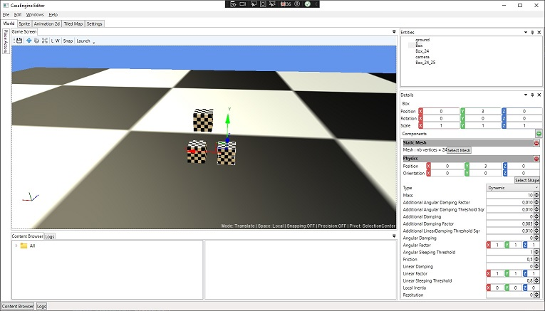
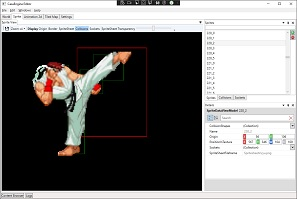
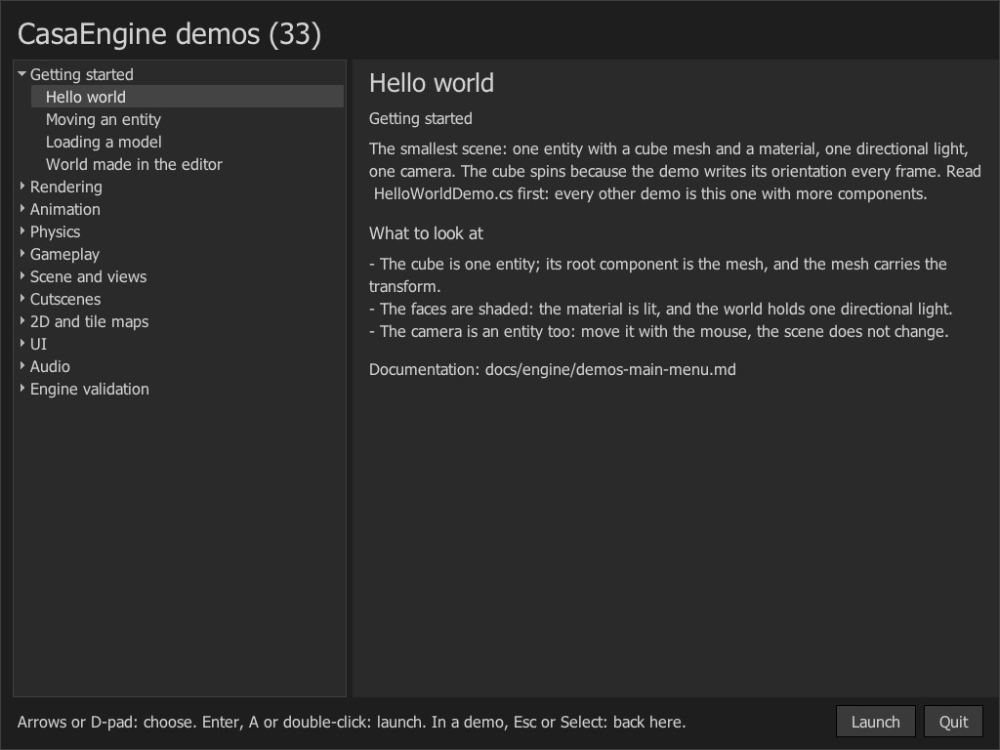
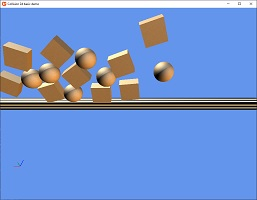
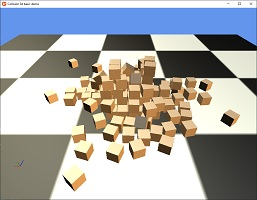

# CasaEngineMonogame
Editor + game engine written in C# .Net 9 with MonoGame.

## Objective:
I developed this engine with the aim of migrating all my game projects to the same engine.

## Contributors
You are welcome, you can contact me with [GitHub Discussions](https://github.com/xcasadio/CasaEngineMonogame/discussions).

## Features
* Editor (written with MGUI)
  - World & Entity editor
  - 2D Graphics
    - Visualization : Sprites, Animations, Tiled map
  - Asset Manager
* UI
  - [MGUI](https://github.com/xcasadio/MGUI)
* 2D
  - Sprites
  - Animations
  - Tiled Map
* 3D
  - Materials
  - Static & Skinned Models (from [willmotil/MonoGameAssimpModelLoader](https://github.com/willmotil/MonoGameAssimpModelLoader))
  - Lighting/Shadows
* Particles
* Physics
  - RigidBody
* Fonts
  - load font from true type font ([FontStashSharp](https://github.com/FontStashSharp/FontStashSharp))

## 3rd parties
* Physics : [bepuphysics2](https://github.com/bepu/bepuphysics2) (2.5.0-beta.29)
* Models & animations: AssimpNET

## Getting started (Windows)
1. Download and install **Visual Studio 2022** and **NET 9**

2. Clone the repository:

```sh
git clone https://github.com/xcasadio/CasaEngineMonogame.git
```

3. Launch the editor
    * Select the CasaEngine.Editor project as startup project
    * Compile and launch

4. Launch a demo
    * Select Debug or Release in the configuration Manager
    * Select the CasaEngine.Demos project as startup project
    * Compile and launch: the main screen lists the demos by theme, with their controls and what to look at
    * In a demo, F1 shows or hides the help panel and Esc returns to the main screen
    * Keyboard or gamepad: each demo lists its keys and buttons, read from `CasaEngine.Demos/Content/demos-input.buttonsMapping`

## Documentation
- Index: [docs/README.md](docs/README.md)
- Demos main screen: [docs/engine/demos-main-menu.md](docs/engine/demos-main-menu.md)
- Materials workflow: [docs/engine/materials-workflow.md](docs/engine/materials-workflow.md)
- Render stats validation workflow: [docs/engine/render-stats-demo-workflow.md](docs/engine/render-stats-demo-workflow.md)

## Screenshots





